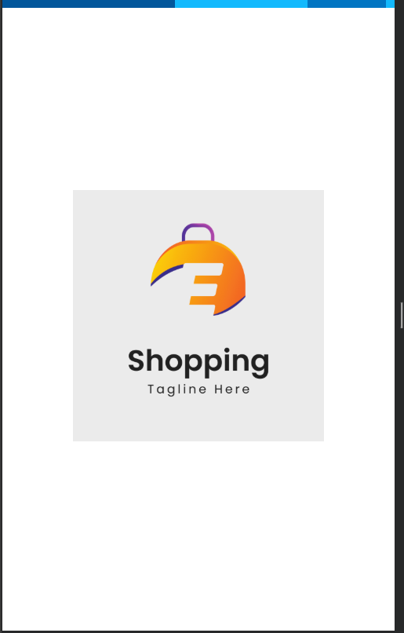
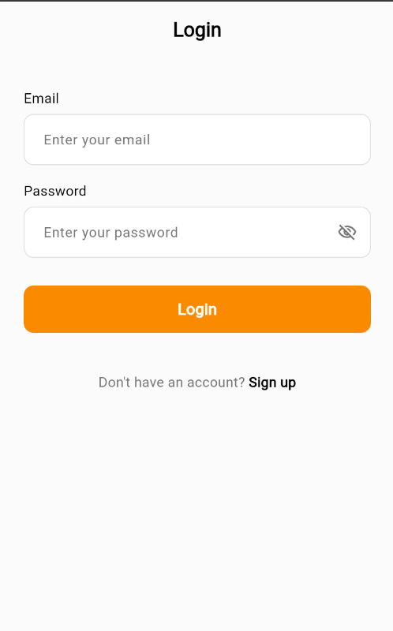
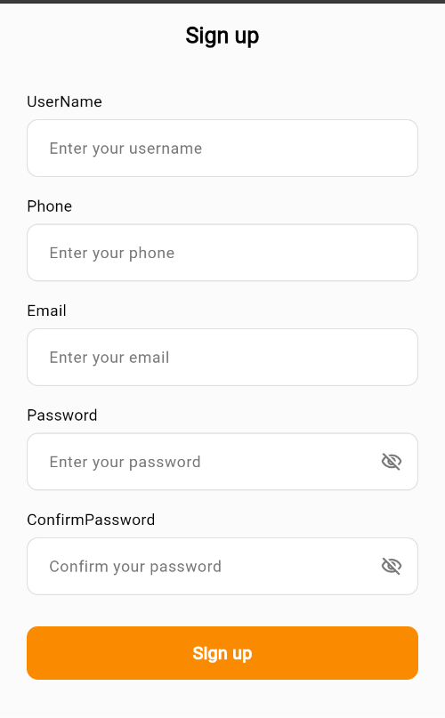
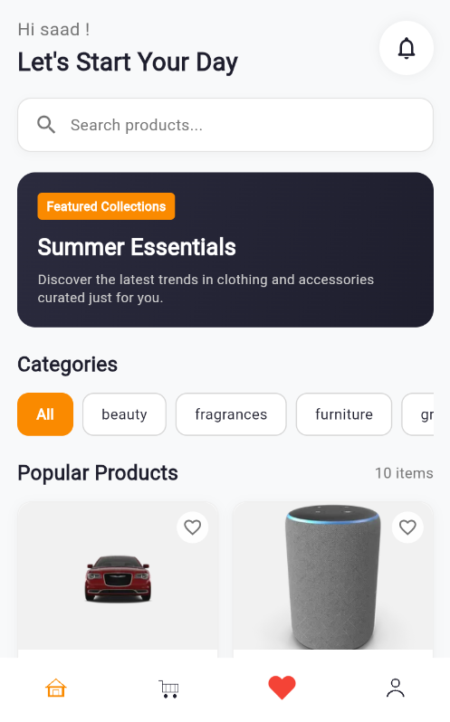
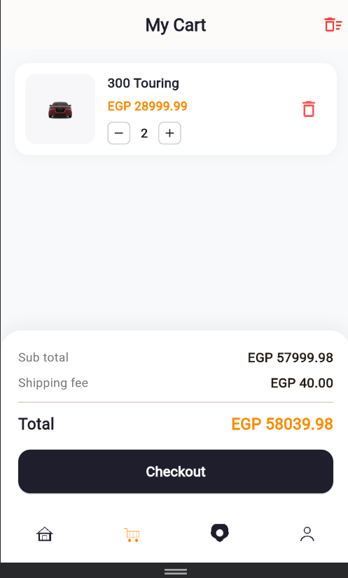
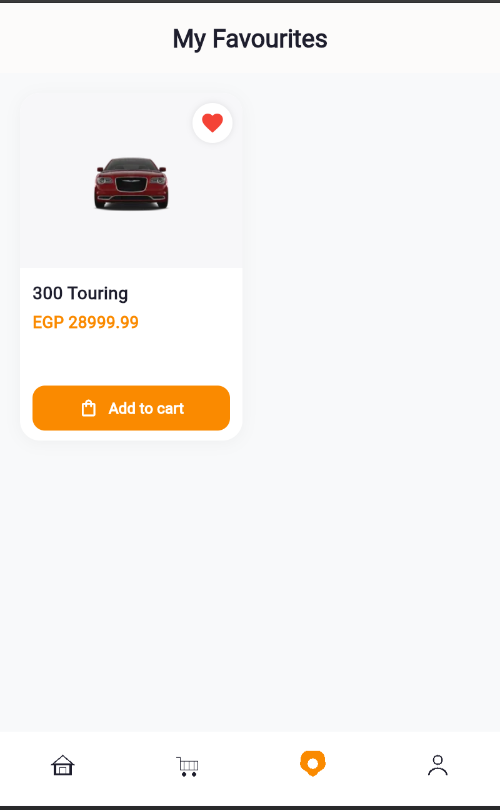
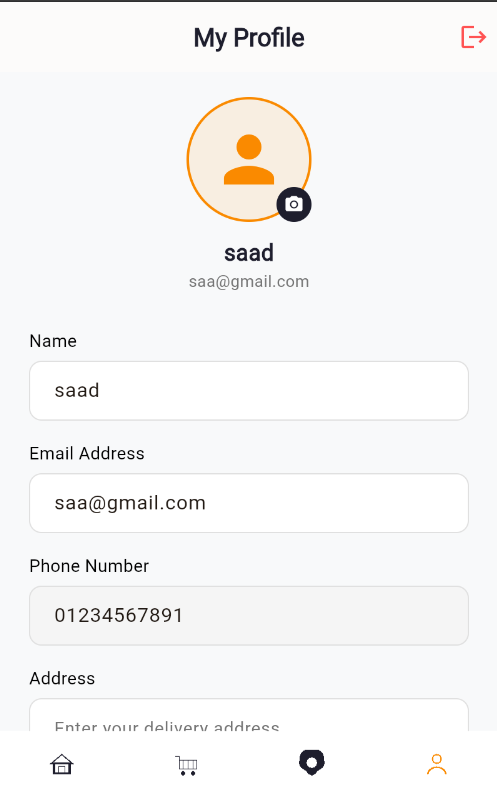

# Shopping App with State Management (Repository Pattern & BLoC / Cubit) 🛒

A modern, responsive Flutter E-Commerce application built as part of the **EraaSoft Flutter Course (Day 13)**. This project demonstrates clean state management using **Flutter BLoC (Cubit)**, the **Repository Pattern** with interfaces, feature-based architecture, live REST API integration, reactive UI states (Loading, Success, Error), local notifications with timezones, offline SQLite caching, and persistent bottom navigation.

---

## 📱 App Screenshots

| Splash Screen | Login Screen | Sign Up Screen |
||||
| White splash branding with asset logo | User authentication & validation | Form validation & account creation |

| Home Screen | Cart Screen | Favorites Screen | Account Screen |
|||||
| BLoC reactive grid & banners | Slug-based category filter chips | Immediate & scheduled (5s) alerts |

---

## ✨ Features

- **State Management with BLoC (Cubit):** Clean separation of UI and business logic using `flutter_bloc` with `HomeCubit` and `HomeState`.
- **Repository Pattern Architecture:** Complete data abstraction separating remote REST APIs, local SQLite caching, and presentation layers (`HomeRepoInterface`, `HomeRepoImp`, `HomeDataSourceInterface`, `HomeDataSourceImp`).
- **Reactive UI States:**
  - **Loading:** Smooth circular progress indicators while fetching data.
  - **Success:** Displays categories horizontally and products in a responsive grid.
  - **Error & Retry:** Clean error UI with a retry mechanism on failure.
- **Infinite Scroll Pagination:** Automatically loads more products as the user scrolls toward the bottom using a `ScrollController` listener.
- **Horizontal Categories:** Scrollable category chips with active styling and slug-based product filtering.
- **Reusable Widgets:** Modular components including `CategoryItem`, `ProductItem` (with `CachedNetworkImage`), `CustomElevatedButton`, and `CustomTextFormField`.
- **Bottom Navigation Shell (`AppSection`):** Layout shell hosting 4 main tabs (`HomeScreen`, `CartScreen`, `FavoriteScreen`, `AccountScreen`) with active icon coloring.
- **Cart & Favorites Management:** Client-managed shopping cart with badge counters and instant favorite toggle.
- **Local Notifications & Timezones:** Immediate local notifications and timezone-aware 5-second background scheduled notifications using `flutter_local_notifications` and `timezone`.
- **Offline SQLite Caching:** Caches products locally using `sqflite` (with WebAssembly support on web) for offline access.
- **Authentication & Persistence:** Secure user registration, login, and persistent session tokens stored with `shared_preferences`.

---

## 📁 Project Architecture

```text
lib/
├── core/
│   ├── constants/
│   │   ├── api_constants.dart
│   │   ├── app_assets.dart
│   │   └── app_colors.dart
│   ├── database/
│   │   └── sqflite_helper.dart
│   ├── local_storage/
│   │   └── cache_helper.dart
│   ├── network/
│   │   └── api_result.dart
│   ├── routes/
│   │   └── app_routes.dart
│   ├── services/
│   │   └── notification_service.dart
│   ├── theme/
│   │   └── app_theme.dart
│   ├── utils/
│   │   └── app_validator.dart
│   └── widgets/
│       ├── custom_elevated_button.dart
│       └── custom_text_form_field.dart
├── features/
│   ├── account/
│   │   ├── data/
│   │   └── presentation/
│   │       └── view/
│   │           └── account_screen.dart
│   ├── app_section/
│   │   ├── app_section.dart
│   │   └── screens/
│   │       └── app_section.dart
│   ├── auth/
│   │   ├── data/
│   │   └── presentation/
│   │       ├── view/
│   │       │   ├── login_view.dart
│   │       │   └── register_view.dart
│   │       └── view_model/
│   ├── cart/
│   │   ├── data/
│   │   └── presentation/
│   │       └── view/
│   │           └── cart_screen.dart
│   ├── favorite/
│   │   ├── data/
│   │   └── presentation/
│   │       └── view/
│   │           └── favorite_screen.dart
│   ├── home/
│   │   ├── data/
│   │   │   ├── models/
│   │   │   │   ├── category_model.dart
│   │   │   │   └── product_model.dart
│   │   │   └── repo/
│   │   │       ├── data_source/
│   │   │       │   ├── home_data_source_interface.dart
│   │   │       │   └── home_data_source_imp.dart
│   │   │       └── repo/
│   │   │           ├── home_repo_interface.dart
│   │   │           └── home_repo_imp.dart
│   │   └── presentation/
│   │       ├── view/
│   │       │   └── home_screen.dart
│   │       ├── view_model/
│   │       │   ├── home_cubit.dart
│   │       │   └── home_state.dart
│   │       └── widgets/
│   │           ├── banner_widget.dart
│   │           ├── category_item.dart
│   │           └── product_item.dart
│   ├── notifications/
│   │   └── presentation/
│   │       └── notifications_demo_screen.dart
│   └── splash/
│       └── splash_screen.dart
└── main.dart
```

---

## 🛠️ Tech Stack & Dependencies

- **Framework:** [Flutter](https://flutter.dev/) (SDK ^3.13.2)
- **Language:** [Dart](https://dart.dev/)
- **State Management:** [flutter_bloc](https://pub.dev/packages/flutter_bloc)
- **HTTP Client:** [http](https://pub.dev/packages/http)
- **Local Database:** [sqflite](https://pub.dev/packages/sqflite) & [sqflite_common_ffi_web](https://pub.dev/packages/sqflite_common_ffi_web)
- **Key-Value Persistence:** [shared_preferences](https://pub.dev/packages/shared_preferences)
- **Local Notifications:** [flutter_local_notifications](https://pub.dev/packages/flutter_local_notifications)
- **Timezone Support:** [timezone](https://pub.dev/packages/timezone) & [flutter_timezone](https://pub.dev/packages/flutter_timezone)
- **Image Caching:** [cached_network_image](https://pub.dev/packages/cached_network_image)
- **REST API:** [Supermarket Backend API](https://supermarket-dan1.onrender.com/api/v1)

---

## 🚀 Getting Started

### Prerequisites

- [Flutter SDK](https://docs.flutter.dev/get-started/install) (v3.13 or newer)
- Dart SDK
- Android Studio / VS Code with Flutter & Dart extensions
- Android device, iOS simulator, or Chrome browser

### Installation

1. **Clone the repository:**
   ```bash
   git clone https://github.com/your-username/day13-shopping-app.git
   ```

2. **Navigate to the project directory:**
   ```bash
   cd day13
   ```

3. **Install dependencies:**
   ```bash
   flutter pub get
   ```

4. **Run the application:**
   ```bash
   flutter run
   ```
   *To run on Chrome:*
   ```bash
   flutter run -d chrome
   ```

---

## 📱 State Management & Repository Pattern Flow

```text
[UI: HomeScreen (BlocBuilder)]
           │
           ▼ (calls getAllProducts / getAllCategories)
      [HomeCubit]
           │
           ▼ (calls abstraction)
   [HomeRepoInterface]
           │
           ▼ (implemented by)
     [HomeRepoImp]
     ┌─────┴─────────────────────────┐
     ▼                               ▼
[HomeDataSourceImp]         [HomeLocalDataSource]
  (Remote REST API)            (SQLite Cache)
     │                               │
     ▼ (returns List<ProductModel>)  ▼ (offline fallback)
[HomeProductLoading / HomeProductSuccess / HomeProductError]
           │
           ▼ (listens & rebuilds)
[BlocBuilder in HomeScreen]
```
